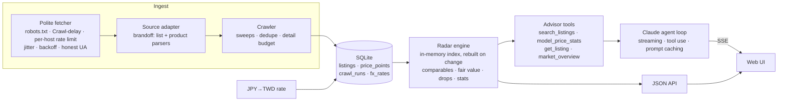

# Kura 蔵 — Japanese pre-owned luxury price radar + AI bag advisor

> 日本二手精品行情雷達與 AI 找包顧問：爬取日本二手精品店的在售包款，計算同型號同成色的行情、降價與銷售速度，並讓 Claude 只根據真實在售商品幫台灣買家找包。

Kura crawls live listings from a Japanese luxury resale store, normalises them into
a price database, and builds two things on top:

- **Price radar (行情雷達)** — fair value per listing from like-for-like comparables,
  deal scores with honest confidence, price-drop tracking, sell-through and
  time-to-sell per model.
- **AI bag advisor (AI 找包顧問)** — a Claude tool-use agent that answers questions like
  *「預算 8 萬，想找通勤可以放 A4 的 LV 托特包」* by querying the radar, and recommends only
  listings that actually exist, with TWD prices and the reasoning behind each pick.

It is a single Go binary (crawler + API + embedded UI) on SQLite.

```
kura crawl            # sweep the configured brands once
kura serve            # http://127.0.0.1:8080  (UI + API + advisor)
```

---

## Architecture



| Package | Responsibility |
|---|---|
| `internal/crawl` | Polite HTTP fetcher; crawler that records sweeps, price changes, sold items |
| `internal/source/brandoff` | BRAND OFF adapter: list/product parsers (fixture-tested) and paginated sweeper |
| `internal/listing` | Source-independent model: condition ranks, categories, brand aliases (EN/中/日) |
| `internal/store` | SQLite schema and queries (pure-Go driver, no cgo) |
| `internal/radar` | Fair value, deal score, confidence, drops, per-model stats |
| `internal/advisor` | Claude agent, tool implementations, offline mock |
| `internal/web` | API, SSE chat endpoint, embedded vanilla-JS UI |

## Design decisions worth reading

### Choosing a source: respect the "no"
The first candidate (KOMEHYO) allows everything in robots.txt but returns errors to any
client that identifies itself as a bot — it only answers browser user agents. Spoofing a
browser to get around that would be evading their bot policy, so Kura doesn't. It uses
BRAND OFF, which serves an honestly identified crawler (`KuraBot/0.1 (+repo URL)`). The
fetcher also:
- reads robots.txt per host and honours `Crawl-delay` when it's longer than the default,
- runs one request at a time per host at ≥ 3 s plus 0–25% jitter,
- backs off exponentially on 429/5xx and honours `Retry-After`,
- caps product-page fetches per run (`-details`); list pages already carry what the radar needs.

### Turning messy listings into comparable data
BRAND OFF titles are Japanese free text with the condition shown only as an icon image.
The adapter:
- maps icon numbers to ranks (新品→N, 未使用品→S, A/B/C),
- splits titles into brand / model name / bag type / gender / model code
  (`ルイ・ヴィトン キーポル55 ボストンバッグ バッグ メンズ レディース M41424`),
- keeps only bag categories (the brand filter returns clothing too; category ids `100xxx` are bags),
- takes the model code from the product page's spec table when available, since that's authoritative.

### Condition grades stay the shop's
Every shop grades differently. Brand Off uses 新品 / 未使用品 / ランクA / B / C, others add
SA / AB / BC, and C2C marketplaces like Mercari let sellers grade their own items. Kura does
not translate these into a house scale:
- Each source registers its **own scheme**: labels, its definitions verbatim, and who grades
  (店家鑑定 or 賣家自評). The UI shows the shop's label, a plain-text meaning, and the shop's
  original wording.
- **"Same condition" means same shop, same grade.** Another shop's "A" only counts through
  an internal rank bridge, at lower confidence.
- The internal N–C scale exists only for cross-grade estimates and the "at least this good"
  filter, and is never displayed in place of a grade.
- Older databases are migrated in place, and missing grades are backfilled from each scheme
  where the mapping is unambiguous.

### Knowing when something sold
A listing that vanishes might have sold, or might just have shifted across a page
boundary during a newest-first sweep. Kura marks an item **gone** only after it is missing
from **two consecutive complete sweeps**. Capped sweeps (`-max-pages`) never mark anything
gone, and reappearing items are reactivated. Time-to-sell only counts items Kura actually
saw being listed (first seen after the initial crawl), because older stock has an unknown
listing date.

### Newest listings
最新上架 (Home's shelf, Browse's newest sort, the advisor's `newest`, the demo member's
新上架) is one order. Listings Kura saw appear after the initial crawl come first, latest
first. The initial crawl's own first-seen times are only crawl order, and list pages are
swept newest first, so among those listings the *earliest* first seen is the shop's newest.
Listings first seen in the same second (about one list page) fall back to id order.

### Fair value with honest confidence
- **Comparables** are the same brand and model code (or model name when there's no code),
  covering active listings plus items gone within 180 days.
- **Same-rank median** when there are ≥ 3 comparables (≥ 6 counts as high confidence).
  Otherwise prices are **rank-adjusted** to A-equivalent (S 1.15, A 1.0, B 0.85, C 0.70, …)
  and confidence drops a level.
- **Dispersion check.** The first live run surfaced "64% below market" Hermès Garden Party
  bags: the name-only group mixed canvas and leather versions. Kura now measures IQR/median
  of the comparables and downgrades confidence above 0.4 (low above 0.6). Groups with no
  model code are always low confidence.
- **Anomaly flag.** The full crawl surfaced an Alma PM (M51130, B rank) at ¥22,000. It had
  46 same-rank comparables with a median of ¥80,000, and the next cheapest was ¥50,000. That
  is almost certainly unlisted damage, not a 73% bargain. Anything more than 50% below a fair
  value is flagged 「異常低價 · 請先確認狀況」, never ranked as a deal, and the advisor is told
  to warn rather than recommend.
- **Deal ranking** is weighted by confidence, so a reliable 15% outranks a shaky 50%. The
  UI labels low-confidence cases 「可能低於行情 · 低信心」 and explains why.
- **Detail fetches go where they matter.** About 46% of listings have no model code in the
  title, so the product-page budget goes to those first (the spec table supplies the code),
  round-robin across brands.

### The advisor agent
- **Manual streaming tool loop** on the Anthropic Go SDK (`Beta.Messages.NewStreaming`).
  Text deltas, tool calls and tool results stream to the browser over SSE, so users can
  watch it search.
- **Grounded by construction.** The model only sees what the tools return. The system
  prompt requires every recommendation to cite a listing id (`[[brandoff:…]]`), which the
  UI renders as a clickable card.
- **Titles are Japanese.** The prompt teaches the model to search with katakana or model
  codes (Neverfull → ネヴァーフル); users type Chinese or English.
- **Tool inputs are validated** (unknown fields, unknown brands, bad enums). Errors go back
  as `is_error` tool results so the model corrects itself. Eager input streaming is on, and
  tools are never run after a `max_tokens` stop.
- **Robustness.** Server-side refusal fallback (`fallbacks: "default"`) and prompt caching on
  the static system prompt and tools. Conversation history is append-only, and a failed
  turn rolls back so the session stays valid.
- **Mock mode.** Without `ANTHROPIC_API_KEY`, a rule-based advisor runs the same search
  tool, so the whole demo works offline.
- **Tested without a key.** `agent_test.go` replays scripted SSE from a fake Messages API
  and asserts the request shape and the tool round trip.

## Running it

Requires Go 1.26+.

```bash
go build -o kura ./cmd/kura
./kura crawl -brands "HERMES,CHANEL,LOUIS VUITTON" -details 100
export ANTHROPIC_API_KEY=sk-ant-...      # optional; without it the advisor runs in mock mode
./kura serve -crawl-every 6h             # keeps the radar fresh; price drops and sold items appear from the 2nd crawl on
```

| Flag | Default | |
|---|---|---|
| `-db` | `kura.db` | SQLite path |
| `-brands` | `HERMES,CHANEL,LOUIS VUITTON,CELINE,LOEWE,GOYARD` | Brands to sweep (EN, 中文 or katakana) |
| `-delay` | `3s` | Minimum gap between requests (robots.txt `Crawl-delay` wins if longer) |
| `-max-pages` | `0` (all) | Cap pages per brand; capped sweeps never mark items sold |
| `-details` | `150` | Product pages fetched per crawl (colour, size, accessories) |
| `-model` | `claude-opus-5-5` (`KURA_MODEL`) | Advisor model |
| `-crawl-every` | off | Background crawl interval while serving |

A full sweep of the six default brands is roughly 300 list pages, about 20 minutes at the
default delay.

### API

| Endpoint | |
|---|---|
| `GET /api/overview` | Counts, FX rate, advisor mode, recent crawl runs |
| `GET /api/listings?brand=&category=&min_rank=&max_twd=&q=&deals=1&sort=deal` | Search |
| `GET /api/listings/{id}` | One listing with price history and model stats |
| `GET /api/models?brand=` · `GET /api/models/{brand}/{key}` | Per-model statistics |
| `GET /api/drops` | Recent price cuts |
| `GET /api/member` | Demo member 林小姐: a watchlist picked from live models and listings, the price cuts and sales the crawl observed on it, and each tracked model's newest listing (see *Newest listings*) |
| `POST /api/chat` `{session, message}` | Advisor, streamed as Server-Sent Events |
| `POST /api/crawl` | Start a crawl in the background |

## Tests

```bash
go test ./...
```

- **Parsers** run against real saved pages (`internal/source/brandoff/testdata`).
- **Store** covers the price-history and sold-detection lifecycle, including the
  "missed once is not sold" rule and reactivation.
- **Radar** covers same-rank and rank-adjusted valuation, dispersion downgrade, drops,
  stats and filters.
- **Agent** runs the full tool loop against a fake streaming API.

## Limitations and next steps

- **One source.** The `crawl.Source` interface is the seam for more resellers. More sources
  also means cross-site comparables and price arbitrage between shops.
- **Variant-aware grouping.** Leather, colour and hardware drive Hermès/Chanel prices, but
  most titles don't carry them. Product-page materials (already stored) could split
  name-only groups.
- **Landed cost.** Prices exclude international shipping and Taiwan import duties/VAT. A
  landed-cost estimator would make TWD comparisons with local listings fair.
- **Marketing automation.** Member segments from advisor conversations, plus Claude-drafted
  LINE/EDM copy for "price dropped on a model you asked about" alerts. The data model
  (price-drop events, per-model interest) already supports it.
- **Observability.** The fetcher keeps request/byte/retry/error counters; exposing them and
  sweep durations as Prometheus metrics is a small step.
- Product images are loaded directly from the source site; a production deployment would
  cache thumbnails and confirm usage terms with the source.
